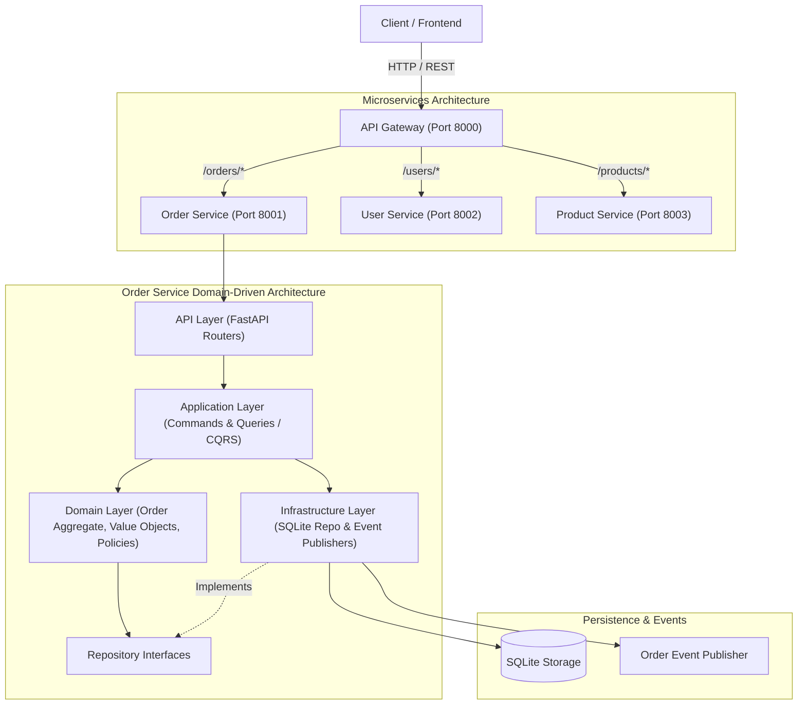

# Distributed Online Order System (Microservices & DDD)

[](https://www.python.org/)
[](https://fastapi.tiangolo.com/)
[](https://en.wikipedia.org/wiki/Domain-driven_design)
[](docker-compose.yml)
[](tests/)
[](LICENSE)

A distributed, production-grade microservices system for order lifecycle management built with **FastAPI**, **Domain-Driven Design (DDD)**, and **CQRS (Command Query Responsibility Segregation)** patterns in Python.

---

## System Architecture



---

## Architectural Patterns & Core Layers

### 1. Domain Layer (`src/domain/`)
- **Aggregate Root (`Order`)**: Enforces business invariants, status transitions (`PENDING` → `CONFIRMED` → `SHIPPED` → `DELIVERED`), and total calculations.
- **Value Objects (`OrderItem`, `Address`)**: Immutable value objects (`@dataclass(frozen=True)`) enforcing business validation rules.
- **Repository Interface (`OrderRepository`)**: Abstract contract decoupling domain logic from persistent storage.

### 2. Application Layer (`src/application/`)
- **CQRS Pattern**:
  - **Commands**: `CreateOrderCommand`, `UpdateOrderStatusCommand`
  - **Queries**: `GetOrderQuery`
  - **Command Handlers**: Orchestrates transaction boundaries, aggregate mutations, repository persistence, and domain event triggering.
  - **DTOs (`OrderItemDTO`)**: Clean separation between internal domain entities and external contracts.

### 3. Infrastructure Layer (`src/infrastructure/`)
- **Persistence (`SqliteOrderRepository`)**: Concrete implementation of the repository contract using SQLite.
- **Event Publisher (`OrderEventPublisher`)**: Dispatches domain events (`order_created`, `order_status_changed`) for event-driven workflows.
- **Service Clients (`ProductServiceClient`)**: Resilient HTTP client communicating with external catalog/inventory services.

### 4. API Layer & Gateway (`api-gateway/`, `src/api/`)
- **API Gateway**: Unified entry point routing requests, handling cross-cutting concerns, and abstracting internal service ports.
- **Order Service Router**: FastAPI endpoints exposing order creation, status transitions, and queries with OpenAPI schemas.

---

## Quick Start

### Option A: Running with Docker Compose (Recommended)
```bash
# Start all microservices and API gateway
docker-compose up --build
```
Services will be accessible at:
- **API Gateway**: [http://localhost:8000](http://localhost:8000) (OpenAPI: `/docs`)
- **Order Service**: [http://localhost:8001](http://localhost:8001)
- **User Service**: [http://localhost:8002](http://localhost:8002)
- **Product Service**: [http://localhost:8003](http://localhost:8003)

### Option B: Running Locally
```bash
# Setup virtual environment
python3 -m venv .venv
source .venv/bin/activate
pip install -r requirements.txt

# Run all services concurrently
bash run_all.sh
```

---

## Automated Test Suites

### 1. Domain & Application Unit Tests (Offline / In-Memory)
Verify business rules, domain invariants, and command handlers without external service dependencies:
```bash
python3 -m unittest discover -s tests -p "test_*.py" -v
```
```
test_handle_create_order (test_command_handlers.TestOrderCommandHandler) ... ok
test_handle_update_order_status (test_command_handlers.TestOrderCommandHandler) ... ok
test_handle_update_order_status_not_found (test_command_handlers.TestOrderCommandHandler) ... ok
test_address_creation (test_domain_order.TestAddressValueObject) ... ok
test_address_validation_empty_field (test_domain_order.TestAddressValueObject) ... ok
test_order_add_and_remove_items (test_domain_order.TestOrderDomain) ... ok
test_order_creation_and_total_calculation (test_domain_order.TestOrderDomain) ... ok
test_order_empty_items_validation (test_domain_order.TestOrderDomain) ... ok
test_order_item_total_calculation (test_domain_order.TestOrderDomain) ... ok
test_order_item_validation_negative_price (test_domain_order.TestOrderDomain) ... ok
test_order_item_validation_negative_quantity (test_domain_order.TestOrderDomain) ... ok
test_order_status_transition (test_domain_order.TestOrderDomain) ... ok

----------------------------------------------------------------------
Ran 12 tests in 0.002s -- OK
```

### 2. End-to-End System & Integration Tests
When the microservices are running:
```bash
python3 test_system.py
python3 test_api.py
```

---

## API Endpoints Reference

| Method | Endpoint | Description |
| :--- | :--- | :--- |
| `GET` | `/health` | System health check |
| `POST` | `/orders/` | Create a new order (triggers `CreateOrderCommand`) |
| `GET` | `/orders/{order_id}` | Fetch order details (triggers `GetOrderQuery`) |
| `PATCH` | `/orders/{order_id}/status` | Update order lifecycle status |
| `GET` | `/users/` | List registered customers |
| `POST` | `/users/` | Create new customer profile |

---

## License

This project is licensed under the [MIT License](LICENSE).
